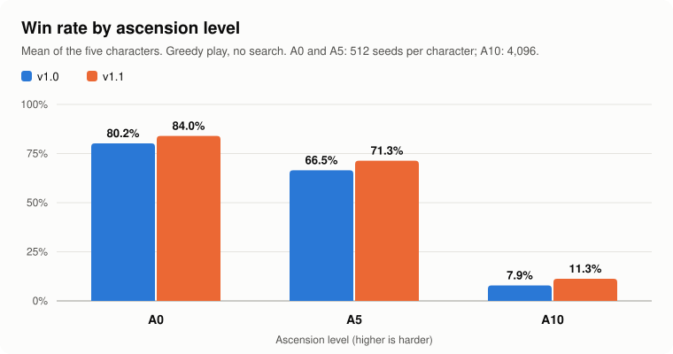

# STS2 AI

An unofficial mod that adds a neural-network player to **Slay the Spire 2**. Let it play whole runs, step it one move at
a time, or keep it beside you as an advisor that shows its chance of winning and its top picks.

It plays with **no search**: every move is one forward pass of a 6.6M-parameter network on your CPU, about 20–30 ms.

**Current release: v1.1**, for game version **v0.107.1** (Steam main branch). [Download](https://github.com/HalfVulpes/sts2ai-mod/releases/latest)

## How well it plays

<picture>
  <source media="(prefers-color-scheme: dark)" srcset="docs/winrate-dark.svg">
  
</picture>

Win rate per character. Each release played the same seeds:
- A0 and A5: 512 seeds per character.
- A10: 4,096 held-out seeds.

All games use greedy play with no search, in the headless host that shares the mod's decision code.

| Character | A0 v1.0 | A0 v1.1 | A5 v1.0 | A5 v1.1 | A10 v1.0 | A10 v1.1 |
|---|---:|---:|---:|---:|---:|---:|
| Ironclad | 89.8% | 96.3% | 86.1% | 89.1% | 14.7% | 21.5% |
| Silent | 67.6% | 75.2% | 49.8% | 59.4% | 2.6% | 4.4% |
| Defect | 83.8% | 84.8% | 72.1% | 77.7% | 8.3% | 10.5% |
| Necrobinder | 72.7% | 75.6% | 51.2% | 54.9% | 1.4% | 2.9% |
| Regent | 87.1% | 88.1% | 73.2% | 75.6% | 12.4% | 17.0% |
| **Mean** | **80.2%** | **84.0%** | **66.5%** | **71.3%** | **7.9%** | **11.3%** |

For comparison, Spire Mentor's search scores 9.1% at A10 on the same 4,096 seeds in our host; v1.1 averages 11.3%
with no search.

## Install

You need Linux, your own copy of Slay the Spire 2 **v0.107.1**, python3 (3.11+), unzip and the
[.NET 9 SDK](https://dot.net). No game files are included.

1. Download `sts2ai-mod-v1.1.zip` from the [release page](https://github.com/HalfVulpes/sts2ai-mod/releases/latest)
   and check it against `SHA256SUMS`.
2. Clone this repository at the same release and run the installer:

   ```bash
   git clone --branch v1.1 https://github.com/HalfVulpes/sts2ai-mod.git
   cd sts2ai-mod
   tools/install_release_mod.sh /path/to/sts2ai-mod-v1.1.zip "/path/to/Slay the Spire 2"
   ```

   The game folder defaults to `~/.steam/steam/steamapps/common/Slay the Spire 2`. The installer checks your game
   version, builds a small headless host, and generates the game vocabulary from **your** installation, since that
   vocabulary is never distributed. It then copies everything into `<game>/mods/sts2ai/`.
3. Start the game, allow mods when it asks, and start a run.

To uninstall, delete `<game>/mods/sts2ai/`. Windows may work (the mod is plain .NET) but is untested, and the
installer is a bash script.

## Use

A panel in the top-right corner shows the AI's view of the current decision: its chance of winning the run, the
floor it expects to reach, and its top choices.

| Key | Button | Action |
|---|---|---|
| F8 | Autoplay | Play by itself, one action every 0.8 s |
| F9 | Step | Play exactly one action |
| F10 | Hide | Hide the panel (a small button stays in the corner) |

With autoplay off you play normally and the panel acts as an advisor. More detail, including co-op and logs, is in
[mod/README.md](mod/README.md).

## Coming next

v1.2 will support the new game version on the beta branch (v0.113.0) and its new character, **The Fool**.

## How it works

The policies are trained with reinforcement learning in a headless copy of the game, using a curriculum that restarts
practice runs where full runs are lost. The method, training code and evaluation are in the paper
[*Zero-Search Reinforcement Learning for Slay the Spire 2 with Failure-Driven Restarts*](https://arxiv.org/abs/2611.12088)
and its repository [HalfVulpes/sts2ai](https://github.com/HalfVulpes/sts2ai). This repository holds the mod and the
release notes ([CHANGELOG.md](CHANGELOG.md)).

## License

GPL-2.0-only ([LICENSE](LICENSE)); see [THIRD_PARTY_NOTICES.md](THIRD_PARTY_NOTICES.md). Slay the Spire 2 and its
assets belong to their rights holders. This project is not affiliated with or endorsed by Mega Crit.
